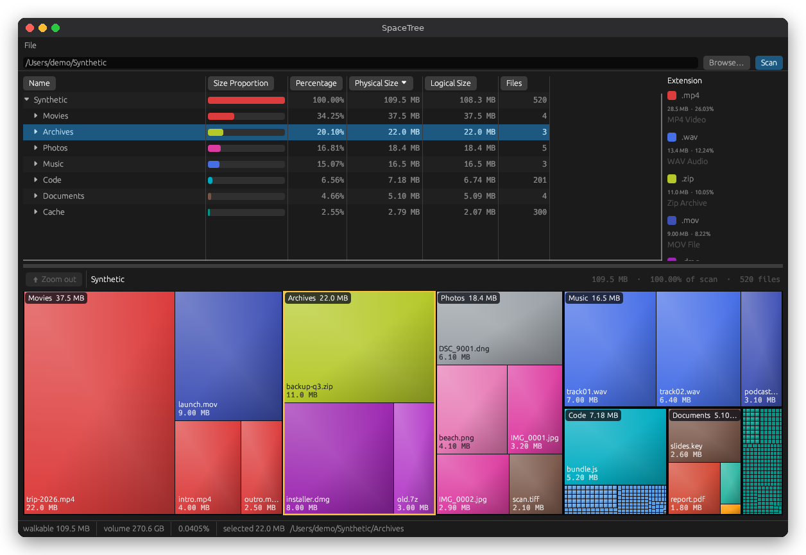

# SpaceTree

SpaceTree is a macOS disk usage app in the spirit of WinDirStat: pick a folder or a whole disk, and see at a glance what is eating your space. A sortable table and a treemap show the same allocated bytes, so the biggest offenders stand out in seconds.

**Use it when** your disk is nearly full and you need to know which folder, file type, or forgotten download is responsible, before you decide what to remove. SpaceTree is read-only: it never deletes anything, and scans stay on your machine (no uploads, no telemetry).



More captures are in [`screenshots/`](screenshots/). They use a synthetic tree, not real files.

- The table columns are Name, Size Proportion, Percentage, Physical Size, Logical Size, and Files. Percentage is that row's allocated bytes divided by the scan root. The scan root is 100%, except when scanning `/` or another local macOS volume root: only its Percentage cell is green and shows `~N% full`, the used space System Settings › Storage shows over the volume's capacity. Child rows and folder scans keep their scan-share percentages.
- Whole-volume scans also show a green `~N% free` summary as soon as filesystem statistics arrive, while the directory scan is still running. It shows the available bytes and capacity at scan start, independently of unreadable paths; ordinary folder scans do not show it.
- Used and available follow System Settings › Storage and Finder. macOS counts purgeable space (local snapshots, caches, files iCloud also holds) as available although it is still on disk, so these figures show more available and less used than `df` does; the summary says how much of the available space is purgeable, and the green cell's tooltip gives the on-disk figure. A volume macOS reports no purgeable space for falls back to the `df` figures.
- A whole-volume scan stays on that volume (it does not enter `/Volumes/*` or mounted disk images) and adds one `Hidden space` row, so the root row equals the used space System Settings shows: used space the scan found in no file it could read. That is folders macOS did not let SpaceTree read, local snapshots, and system data outside the scanned folders. To move more of it into folders, turn on Full Disk Access for SpaceTree in System Settings › Privacy & Security and scan again. Purgeable files the scan did read (caches, iCloud-held files) still count at full size in their folders, so the row can understate what is hidden.
- The treemap draws one rectangle per file. Area is allocated size. Color is the file extension. Each folder is outlined around its files; large folders carry a name and size label, and large files show their name and size. Hover a tile for its size, kind, and share of the view and of the scan. Double-click a folder (or its label) to zoom in. Double-click a file to reveal it in Finder. Right-click a table row, treemap tile, or folder label to reveal it in Finder or copy its path. The bar above the map shows the path you are in; click any part of it to jump back, or press Esc or Zoom out to go up one level. A single click selects a row and does not zoom; selecting a folder in the table outlines it in the map.
- The table context menu also opens directly on a folder's name. Right-click selects that target before offering Reveal in Finder or Copy Path. Finder receives the original filesystem path, including names with spaces or non-UTF-8 bytes; a failed reveal appears in the status area.
- The legend lists the extension colors in the current scan with each one's size and share. Hover a legend row to highlight that extension in the map.

Physical Size is allocated bytes (`st_blocks * 512`). Logical Size is `st_size`. Sizes use decimal units, as Finder does (1 GB = 1,000,000,000 bytes); hover a size for the exact byte count. The volume size is the capacity `statfs` reports, the same figure `df` shows. A directory's size is the sum of its children. APFS clones share their blocks, and the scan counts each shared block once: a pure clone (`cp -c`, Finder Duplicate) counts as zero after the first file seen, and a clone later edited in part counts only the blocks it no longer shares. `du` counts every clone in full. The walk does not follow a child symlink. It skips `/System/Volumes` unless that path is the scan root, so the Data volume is not counted twice.

## Requirements

- macOS 12 or newer, for the app bundle.
- Rust. `Cargo.toml` records `rust-version` 1.85.0. The pinned `eframe` 0.31.1 crates need a newer compiler. Homebrew rustc 1.98 builds this tree.
- Xcode Command Line Tools, for linking and `codesign`.

`cargo test` also builds on Linux. That build reads directories with ordinary file metadata. It does not read APFS clone ids or shared extents.

## Build and run

From the repo root:

```bash
cargo test
cargo run -- --scan /path/to/folder
```

`--scan` prints header lines, starting with `volume_total_bytes` and `root_size_bytes`, then one indented line per node. A whole-volume scan adds `volume_used_bytes`, `hidden_bytes`, and `volume_on_disk_bytes`, and when macOS reports purgeable space, `volume_available_bytes` and `volume_purgeable_bytes`. If some entries could not be read, the report adds `scan_incomplete_errors`, retains readable results, and exits nonzero with a warning on stderr. A root directory that cannot be read fails without a report. The app keeps an incomplete-scan warning visible alongside partial results.

To compare SpaceTree's volume figures with System Settings or Finder without waiting for a scan:

```bash
cargo run -- --volume /
```

It prints the same `volume_*` lines, then `macos_available_bytes[<mount>]`, the unfiltered answer macOS gave for each mount. These figures are estimates that macOS refreshes on its own schedule, so expect them to be close to its windows, not identical.

## Ollama models

Ollama stores each model layer once as `~/.ollama/models/blobs/sha256-<hash>`, so the folder is a list of hashes with no model names. SpaceTree reads the manifests next to it and names the blobs:

- In a scan that contains an Ollama `models` folder, each blob's table row and treemap tile shows the model and layer kind in front of the hash (`llama3:latest · model`, or `llama3:latest +1 · model` when two models share it). The tooltip lists every model that uses it and the `ollama rm` command that frees it. Blobs no model lists and unfinished downloads are labelled as such.
- `--ollama` prints the same as a report, with no scan:

```bash
cargo run -- --ollama            # $OLLAMA_MODELS, or ~/.ollama/models
cargo run -- --ollama /path/to/models
```

It lists each model with its blobs and sizes, which blobs are shared, how much removing each model alone frees, blobs no model uses, unfinished downloads, and models whose blobs are missing. It ends with the `ollama rm` commands sorted by space freed. SpaceTree does not run them or delete anything; Ollama itself removes unused blobs when its server starts, unless `OLLAMA_NOPRUNE` is set.

Package the app:

```bash
./scripts/make-app.sh
open dist/SpaceTree.app
```

`scripts/make-app.sh` builds a release binary, copies `Info.plist`, builds `AppIcon.icns` from `assets/AppIcon.png`, and ad-hoc signs `dist/SpaceTree.app`. The icon source is `assets/icon.svg`; `node scripts/render-icon.cjs` re-renders the PNG (it needs Playwright). The bundle id is `com.cgfixit.spacetree`, version 0.1.0. The app is not signed with an Apple Developer ID. On first launch, right-click SpaceTree.app and choose Open, then confirm.


Every merge to `main` whose checks all pass is published as a GitHub release by `.github/workflows/auto-release.yml`, tagged `v<version>-main.<date>.<sha>`. It starts when the bundle or test run for that commit finishes and waits up to 30 minutes for the remaining checks, so the release normally appears a few minutes after the merge; a three-hourly schedule retries anything slower. `release.yml` publishes a named `v<version>` release from the latest successful main bundle, and `release-bundle.yml` is a manual workflow that builds `SpaceTree.app` fresh from any ref and publishes it (as a draft by default) with a tag you choose.

## Repeatable scan comparison

Build two revisions with separate `CARGO_TARGET_DIR` values, then run:

```bash
python3 scripts/bench-scan.py /path/to/baseline/spacetree /path/to/candidate/spacetree
```

The script creates and removes a temporary tree of 6,000 files, warms each binary once, alternates seven timed CLI scans, and rejects differing root byte totals or row counts. The median includes process startup and report formatting. This local fixture does not exercise USB or network-volume behavior.

## Where the code lives

- `src/scan.rs` walks the tree and records allocated size, logical size, file count, and extension.
- `src/layout.rs` places the treemap.
- `src/app.rs` draws the table, the map, and the legend.
- `src/format.rs` prints the `--scan` report.
- `src/ollama.rs` reads Ollama manifests and maps blobs to models.

## License

MIT. See `LICENSE`.
