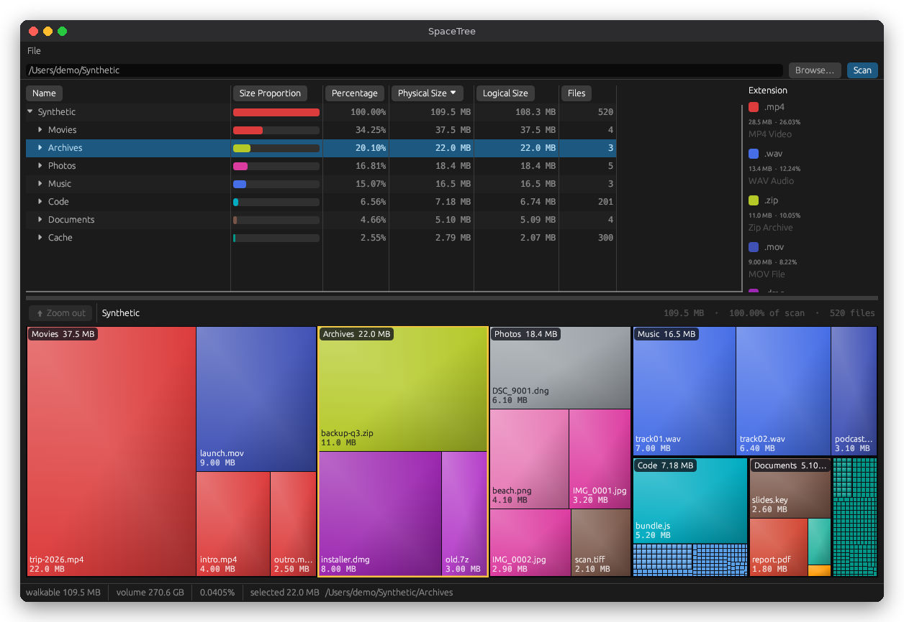

# SpaceTree

SpaceTree is a macOS disk usage app in the spirit of WinDirStat: pick a folder or a whole disk, and see at a glance what is eating your space. A sortable table and a treemap show the same allocated bytes, so the biggest offenders stand out in seconds.

**Use it when** your disk is nearly full and you need to know which folder, file type, or forgotten download is responsible, before you decide what to remove. SpaceTree is read-only: it never deletes anything, and scans stay on your machine (no uploads, no telemetry).



More captures are in [`screenshots/`](screenshots/). They use a synthetic tree, not real files.

## The window

- **Table.** Columns are Name, Size Proportion, Percentage, Physical Size, Logical Size, and Files; click a header to sort. Use the disclosure arrow to expand a folder and its name to select or zoom. Percentage is a row's allocated bytes divided by the scan root. Hover a size for the exact byte count.
- **Treemap.** Files with allocated bytes appear as tiles. Dense views group small items under a non-actionable Other tile. Area is allocated size and color is the file extension. Folders are outlined, and large folders and files carry a name and size. Hover a tile for its size, kind, and share of the view and of the scan.
- **Legend.** The extension colors in the scan, each with its size and share. Hover a row to highlight that extension in the map.
- **Navigation.** A single click selects, and selecting a folder in the table outlines it in the map. Double-click a folder or its label to zoom in; double-click a file to reveal it in Finder. The bar above the map shows where you are: click any part of it to jump back, or press Esc or Zoom out to go up one level.
- **Context menu.** Right-click a table row, tile, or folder label to reveal it in Finder or copy its path. Finder receives the original path, including names with spaces or non-UTF-8 bytes.

## Scanning a whole disk

Scanning `/` or another local macOS volume root adds what a folder scan does not have:

- **Green figures.** The root row's Percentage cell is green and shows `~N% full`, and a green `Whole volume: ~N% free` line appears as soon as the scan starts. Folder scans show neither.
- **They match System Settings › Storage.** macOS counts purgeable space (local snapshots, caches, files iCloud also holds) as available although it is still on disk. SpaceTree asks macOS for that Available figure, so used is capacity minus available, and the green line says how much of it is purgeable. The cell's tooltip gives the on-disk figure `df` prints. A volume macOS reports no purgeable space for uses the `df` figures.
- **Hidden space.** One extra row holds used space the scan found in no file it could read. It fills a positive difference. If the walk already exceeds Used, the root retains the walked total. Hover it for its two parts:
  - *Outside this volume:* the other volumes of the same APFS container (VM swap, Preboot, Recovery, Update), less purgeable space. System Settings counts them as used, and no permission lets a scan into them. On a GitHub macOS runner this is about 9 GB of a 10.8 GB Hidden space. `--scan` prints it as `hidden_outside_bytes`.
  - *On this volume:* folders the scan could not open, snapshots, and file system metadata. Purgeable files the scan did read still count at full size in their folders, so this part can understate what is hidden.
- **Refused folders.** Counts cover every refusal. The tooltip shows up to 24 paths and the CLI lists up to 64. SpaceTree distinguishes ordinary permissions, system-owned folders and macOS refusals. Ownership and the Full Disk Access probe are clues. The specific cause may remain unknown.
- **The Data volume.** `/` shows the Data volume only through its firmlinks (`/Users`, `/Applications`, …). A scan of `/` also walks what the Data volume keeps outside them and lists it as `System/Volumes/Data`, so readable files there are no longer part of Hidden space.
- **One volume only.** The scan does not enter other mounts (`/Volumes/*`, mounted disk images), also when the root is reached through a symlink.

### Full Disk Access is on, but folders are still refused

SpaceTree checks whether macOS actually lets it read privacy-protected files when a scan encounters a macOS operation denial, and says so when it does not. The usual causes:

- **The app was updated.** SpaceTree is ad-hoc signed, without an Apple Developer ID, so macOS cannot tell a new build from a different app, and a grant made for the old copy does not apply to the new one, although System Settings still shows SpaceTree as allowed. Remove SpaceTree from the Full Disk Access list with the − button, add the new copy with +, and scan again.
- **You ran the command line.** For `spacetree --scan` started from Terminal, macOS checks the terminal app's grant, not SpaceTree's.
- **The folders are system-only.** Full Disk Access does not make a user root. System-owned folders may still deny access through ordinary file permissions or an ACL.

## Disks, USB drives, and network shares

The **Volumes** button lists what is mounted: the startup disk, other disks (APFS, Mac OS Extended, ExFAT, MS-DOS (FAT), NTFS, disk images), and network shares (SMB, AFP, NFS, WebDAV), each with its file system and free space. Choosing one scans it. `spacetree --volumes` prints the same list. Mounts macOS hides from Finder (`nobrowse`), such as the boot volume group's `/System/Volumes/*` and autofs maps, are not listed.

- **A local disk's root** scans as a whole volume, as described above.
- **A network share** scans like a folder: no fullness cell and no Hidden space, because the server's totals belong to the whole server volume, not to the share. Every folder listing is a round trip to the server, so a large share takes longer than a local disk.

## How sizes are measured

- **Physical Size** is allocated bytes (`st_blocks * 512`) for regular files. Symlinks use their link-text length; **Logical Size** is `st_size`. A folder is the sum of its children. Units are decimal, as in Finder (1 GB = 1,000,000,000 bytes).
- **One system call per batch.** On macOS the scan lists each directory with `getattrlistbulk`, which returns names, sizes, dates, and APFS clone ids together, and walks subdirectories in parallel. On Linux, where the crate also builds and tests, it uses ordinary file metadata, without clone ids.
- **APFS clones count once.** A pure clone (`cp -c`, Finder Duplicate) counts as zero after the first file seen. A clone later edited in part counts only the blocks it no longer shares, read from its physical extents when available. Unavailable extent maps fall back to full allocation. `du` counts every clone in full.
- **No double counting.** A file with several hard links counts once. Child symlinks are not followed, and `/System/Volumes` is skipped unless it is the scan root, so the Data volume is not counted twice.
- **Errors do not stop a scan.** An unreadable entry is counted and the rest is reported. An unreadable scan root fails the scan. A whole-volume scan also stops if macOS cannot list the mounts it must exclude.

## Ollama models

Ollama stores each model layer once as `~/.ollama/models/blobs/sha256-<hash>`, so the folder is a list of hashes with no model names. SpaceTree reads the manifests beside it and names the blobs. It only reads: nothing is run or deleted.

- **In a scan** of the `blobs` folder or anything above it, each blob's row and tile shows the model and layer kind in front of the hash: `llama3:latest · model`, or `llama3:latest +1 · model` when two models share it. The tooltip lists every model that uses the blob. Blobs no model lists and unfinished downloads are labelled as such.
- **`--ollama`** prints a report without a scan: each model with its blobs and sizes, shared blobs, allocation referenced exclusively by each model, unused blobs, unfinished downloads, models with a missing blob, and `ollama rm` commands ranked by exclusive allocation. Actual space reclaimed can differ. If a manifest is unreadable, invalid, or exceeds 4 MiB, the inventory is incomplete. SpaceTree suppresses removal estimates and marks unmatched ownership unknown. Ollama itself removes unused blobs when its server starts, unless `OLLAMA_NOPRUNE` is set.

## Command line

Scan reports escape backslashes and control characters in entry names so each entry occupies one line.

```bash
cargo run -- --scan /path/to/folder   # text report of a scan (--depth N limits the rows)
cargo run -- --volume /               # volume figures only, no scan
cargo run -- --volumes                # mounted disks and network shares
cargo run -- --ollama                 # $OLLAMA_MODELS, or ~/.ollama/models
cargo run -- --gui-scan /path         # open the app and scan
```

- `--scan` prints header lines, starting with `volume_total_bytes` and `root_size_bytes`, then one indented line per node. A whole-volume scan adds `volume_used_bytes`, `hidden_bytes`, `hidden_outside_bytes`, `volume_on_disk_bytes`, and, when macOS reports purgeable space, `volume_available_bytes` and `volume_purgeable_bytes`. If entries could not be read it adds `scan_incomplete_errors`, lists up to 64 sample paths on stderr with their refusal classifications, and exits nonzero, also when every refusal is system-only.
- `--volume` prints the same `volume_*` lines, then `full_disk_access=granted` or `denied` when the probe is conclusive on macOS, then `macos_available_bytes[<mount>]`, the unfiltered answer from macOS. If the filesystem lookup fails, the command exits nonzero and reports the operating system error. Use it to compare with System Settings. macOS refreshes these estimates on its own schedule, so expect close, not identical.
- `--volumes` prints one line per mounted volume: kind (`startup`, `local`, `network`), file system, free space, capacity, and mount point.

## Build and package

You need macOS 12 or newer, Xcode Command Line Tools, Python 3 and Rust. The locked CLI builds with Rust 1.85.0 on Apple silicon.

```bash
./scripts/make-app.sh
open dist/SpaceTree.app
```

`scripts/make-app.sh` builds a release binary, builds `AppIcon.icns` from `assets/AppIcon.png`, and ad-hoc signs `dist/SpaceTree.app` (bundle id `com.cgfixit.spacetree`). The app is not signed with an Apple Developer ID: on first launch, right-click SpaceTree.app and choose Open, then confirm.

## Releases

The newest `main` commit whose required checks succeed is published as a GitHub release by `.github/workflows/auto-release.yml`, tagged `v<version>-main.<date>.<sha>`. It starts when the bundle or test run for that commit finishes and waits up to 30 minutes for the remaining checks, so the release normally appears a few minutes after the merge. A newer head can supersede an earlier merge while checks are pending. `release.yml` publishes a named `v<version>` release, and `release-bundle.yml` builds and publishes the app from any ref on demand.

## Comparing scan speed

Build two revisions with separate `CARGO_TARGET_DIR` values, then run:

```bash
python3 scripts/bench-scan.py /path/to/baseline/spacetree /path/to/candidate/spacetree
```

It times alternating CLI scans of a temporary 6,000-file tree and rejects differing totals or row counts.

## Where the code lives

- `src/scan.rs` walks the tree and reads sizes and volume figures.
- `src/layout.rs` places the treemap.
- `src/app.rs` draws the table, the map, and the legend.
- `src/format.rs` prints the `--scan` and `--volume` reports and the refused-folder lines.
- `src/volumes.rs` lists mounted disks and network shares for the Volumes button and `--volumes`.
- `src/ollama.rs` maps Ollama blobs to models.

## License

MIT. See `LICENSE`.
